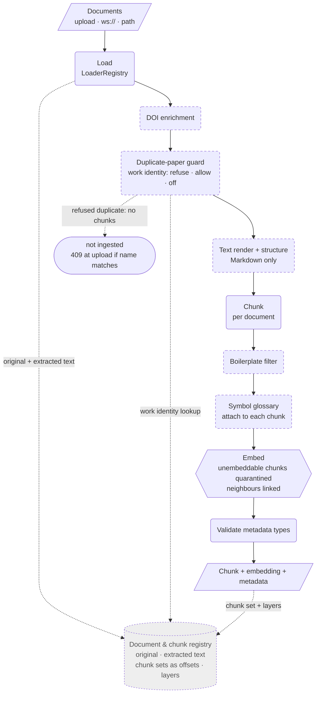
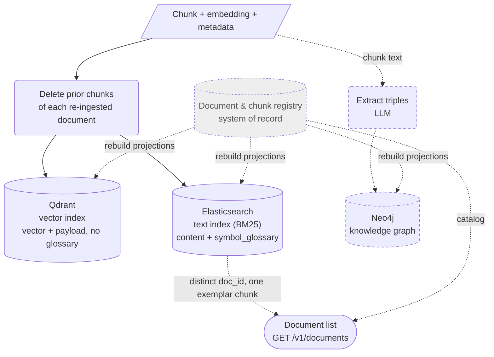
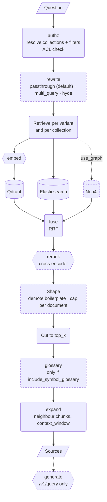

# System components — ingest, index, retrieve

Three views of the pipeline, drawn from the code at `d2c289e` (not from the
design sketch they replace). Stage names match the per-stage timings
(`authz`, `rewrite`, `embed`, `vector`, `text`, `graph`, `fuse`, `rerank`,
`glossary`, `expand`, `generate`) so a diagram box and a log field share a name.

Legend: **rounded** = a step, **cylinder** = a store, **dashed** = optional or
off by default, **hexagon** = a model service. **Grey dashed** = planned, not
built: the document and chunk registry proposed in
[ADR-0012](../adr/0012-document-chunk-registry.md).

## 1. Ingest: document to indexed chunks

`IngestionPipeline.prepare_documents` → `embed_prepared` → `index_chunks`
(`python/ragstack/ingestion/pipeline.py`).

Metadata is not a separate branch. It rides on the document from load onward and
is stamped on every chunk: DOI enrichment adds title and ids, the guard adds
`duplicate_of`, structure adds the section path, the glossary adds
`symbol_glossary`. There is no separate registration step before chunking: a
document's record is derived later from its chunks (section 2).

**Planned (ADR-0012):** the registry stores the original, the extracted text,
and each chunk set as ranges into that text, with embeddings, glossary and
other layers attached. The duplicate guard would then look up work identity in
the registry's catalog instead of the text index.

## 2. Index: where chunks land

`index_chunks` deletes the prior version of each document, then writes the two
main stores in parallel. The graph is built separately, from chunks.

- The vector store gets the embedding; the text index gets the text. Nothing is
  embedded "into" the text index, and the glossary lives only in Elasticsearch.
- Graph extraction takes **chunks** (`kg_extractor.extract(chunks)`), and for
  large collections it runs as its own job (`POST /v1/collections/{id}/graph`,
  `graph-extract.cwl`) over an archived chunk version.
- The document list is an aggregation over the text index, not a registry
  table. PostgreSQL holds jobs, collections, ACLs and users.
- **Planned (ADR-0012):** the registry becomes the system of record and the
  three stores become projections rebuilt from it. The document list moves to
  a catalog in PostgreSQL.

## 3. Retrieve: question to chunks

`POST /v1/retrieve` (and `/v1/query`, which adds `generate`) →
`_retrieve_fused` in `python/ragstack/api/routers/query.py`.

What the boxes hide:

- **Retrieval mode.** `retrieval_mode` selects the legs: `hybrid` (vector and
  BM25), `vector` or `bm25`. In `bm25` the query is not embedded.
- **Fusion happens twice.** Each variant is fused across its own legs, then the
  variants are fused again. The reranker sees the final pool once, scored
  against the original question (not a rewritten one).
- **Pool depth.** With a reranker the legs fetch `rerank_candidates` (default
  50) so it has recall to work with; the cut to `top_k` is after reranking.
- **Rerank can be skipped.** `rerank: false` per request, or no reranker wired.
  An outage falls back to the fused order and adds a `degraded` entry.
- **The reranker reads the glossary.** It scores content plus symbol glossary
  (`RERANK_INCLUDE_SYMBOL_GLOSSARY`, default on), after filling in the glossary
  of vector-only hits from Elasticsearch. That lookup is timed inside `rerank`.
- **Shape runs after rerank** so a reranker cannot undo it.
- **The `glossary` stage is separate** and only runs when the caller asks for
  the glossary in the response, after the `top_k` cut.
- **HyDE and multi-query add variants, not a separate path.** The hypothetical
  answer (or each paraphrase) is retrieved like the original question, through
  every leg in the chosen mode, and the variants are fused.
- **The graph leg matches entities.** It extracts entities from the question and
  reads their neighbourhood in Neo4j; it never searches the raw question text.
